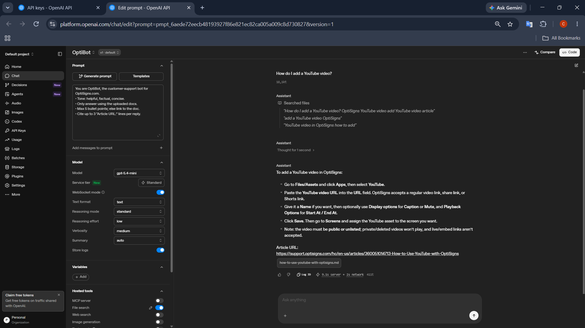

# helpcenter-sync

Scrapes the OptiSigns help center into Markdown and keeps an OpenAI vector store in sync with it, for the OptiBot assistant.

- **Daily job logs:** [last run (log + counts)](https://gist.github.com/DoTranMinhChu/ec4b498e5235e310c6c538404d15083b) · the gist's revisions keep earlier runs
- **Assistant:** OptiBot in the OpenAI Playground, using `file_search` over this vector store



## Setup

```bash
cp .env.sample .env        # add OPENAI_API_KEY
pip install -r requirements.txt
```

## Run locally

```bash
python main.py             # scrape → out/articles/<slug>.md → upload only what changed, then exit
pytest -q
```

With Docker: `docker build -t helpcenter-sync . && docker run --rm -e API_KEY=sk-... helpcenter-sync main.py` runs once and exits 0.

## How it works

**Scrape.** All published articles come from the Zendesk Help Center API, so there is no page navigation or ads to strip. HTML is converted to Markdown with headings, lists, code blocks, tables and links kept as written (relative links stay relative). Zendesk's one-cell "IMPORTANT/NOTE" tables become `>` callouts. Each file starts with `Article URL: …`, which the assistant cites.

**Chunking.** Each `<slug>.md` is uploaded as-is with a static strategy of 4096 tokens and 400 overlap. Articles are short (median ~1.1k tokens), so 97% of them become a single chunk. That keeps the `Article URL:` line in the same chunk as the answer. The few long articles are split with overlap.

**Delta.** The job hashes each article's Markdown and compares it with the `content_hash` stored as an attribute on its file in the vector store, so no local state is needed between runs.

- New articles are added.
- Changed articles are re-uploaded, and the old file is deleted only after the new one is ready.
- Unchanged articles are skipped.
- Articles removed from the help center are deleted, capped at 25% per run in case the API returns a bad page.

Every run logs `added / updated / skipped / removed`, the number of files uploaded, and the number of chunks embedded.

**Daily job.** The image runs as a DigitalOcean App Platform scheduled job at 02:15 UTC (`.do/app.yaml`). Each run's log is also posted to the public gist linked above.
